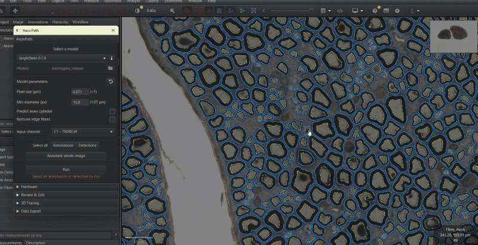

# Review & Edit

Segmentation is rarely perfect. The **Review & Edit** section of the AxonPath panel lets you correct
results by hand with QuPath's drawing tools and then recompute the hierarchy and measurements,
without running the model again.

## Key terms

If you are new to QuPath, these terms are used throughout this page (see QuPath's
[Objects](https://qupath.readthedocs.io/en/stable/docs/concepts/objects.html) page for more):

- **Annotation:** an object you can draw and edit, e.g. the region you segmented.
- **Detection:** an object created by an analysis. Detections can be deleted but not edited. AxonPath
  creates its results (Fibre, InnerCylinder, Axon) as detections.
- **Parent:** the annotation you segmented. The fibres are stored inside it.
- **Locked:** a locked annotation cannot be moved or edited, which prevents accidental changes.
  AxonPath locks the parent after segmentation, and the objects it converts to annotations.
- **Classification:** the class of an object (`Fibre`, `InnerCylinder` or `Axon`). AxonPath uses it to
  know what each object you draw is.

## Why objects need converting

AxonPath creates its results as **detections**, which QuPath does not let you edit. To correct them
they are converted to **annotations**, edited, and converted back when measurements are recomputed.

## Workflow

1. **Select the parent** annotation (the region you segmented).
2. Click **Convert detections to annotations**. All Fibre, InnerCylinder and Axon detections under
   the parent become annotations. They are locked, to prevent accidental edits.
3. **Unlock** them:
   - all at once, with the unlock button; or
   - one at a time, as you edit them: right-click the object → **Annotations → Unlock**. Slower, but
     safer, because everything you are not working on stays protected.
4. **Edit** with QuPath's tools (see [Editing in QuPath](#editing-in-qupath)):
   - Delete wrong objects.
   - Reshape objects with the brush or wand, or by editing their vertices.
   - Draw missing objects and set their class to `Fibre`, `InnerCylinder` or `Axon`.
5. **Lock** them again with the lock button if you want to protect them from further edits.
6. **Select the parent** again and click **Recompute hierarchy & measurements**.

**Measurements are not updated while you edit.** They are recalculated only when you click
**Recompute**, so always recompute before looking at or exporting the measurements.

The buttons are enabled only when they can be used: convert needs a selected parent with AxonPath
detections, and recompute, lock and unlock need a selected parent with AxonPath annotations.

## Editing in QuPath

The tools below are QuPath's own. QuPath's
[Annotating images](https://qupath.readthedocs.io/en/stable/docs/starting/annotating.html) page
describes them in detail, and the [Shortcuts](https://qupath.readthedocs.io/en/stable/docs/reference/shortcuts.html)
page lists their keyboard shortcuts.

- **Select** an object by clicking it.
- **Delete** a selected object with the Delete key.
- **Reshape** an object: select it, then paint with the **Brush** tool (`B`) to add to it. Hold `Alt`
  to erase instead.
- **Draw** a new object with the **Brush** (`B`) or **Polygon** (`P`) tool, with nothing selected.
- **Set its class:** right-click the object → **Set classification** → `Fibre`, `InnerCylinder` or
  `Axon`.
- **Lock or unlock** an object: right-click it → **Annotations → Lock** / **Unlock**.

### Drawing a missing fibre

Draw the objects from the outside in, and **lock each one before drawing the next one inside it**.
Otherwise painting inside an unlocked object can change that object instead of creating a new one.

1. Draw the fibre and set its class to `Fibre`. Lock it.
2. EM only: draw the inner cylinder inside it and set its class to `InnerCylinder`. Lock it.
3. Draw the axon inside it and set its class to `Axon`.

Repeat for every missing fibre. You don't need to recompute after each one: when you have finished
all your edits, select the parent and click **Recompute hierarchy & measurements** once.

Every fibre needs an axon. In EM, where inner cylinders were segmented, a fibre you draw also needs
an inner cylinder around its axon: Recompute does not create one, and removes fibres without one,
together with their axons. Axons and inner cylinders that are not inside a fibre are removed too.

## What Recompute does

For each selected parent, Recompute:

1. Collects the AxonPath annotations inside it, on the same z-slice and timepoint.
2. Converts them back to detections.
3. Rebuilds the hierarchy as segmentation does: each inner cylinder is assigned to the fibre that
   contains it, each axon to the inner cylinder (EM) or fibre (brightfield) that contains it, and
   objects outside any fibre, or fibres missing their contents, are removed.
4. Recomputes all [measurements](measurements.md).

So an object you draw only needs the right class and position; its place in the hierarchy is worked
out for you. A child object must lie (at least 90%) inside its parent object to be assigned to it;
parts sticking out of the parent are clipped.

Converting and recomputing create new objects. This means `Axon ID` from [3D tracing](tracing.md) is
removed, and object IDs change. Run tracing and export measurements after your last recompute.

## Tips

- **Classes:** AxonPath adds `Fibre`, `InnerCylinder` and `Axon` to QuPath's class list
  automatically, so they are available when drawing new objects.
- **Z-stacks:** Recompute and lock/unlock only affect objects on the parent's own z-slice. Select the
  parent on each slice you edited.
- **Deleting a fibre:** delete the fibre together with its axon and inner cylinder. Otherwise the
  leftovers are removed on recompute if they are not inside another fibre.
