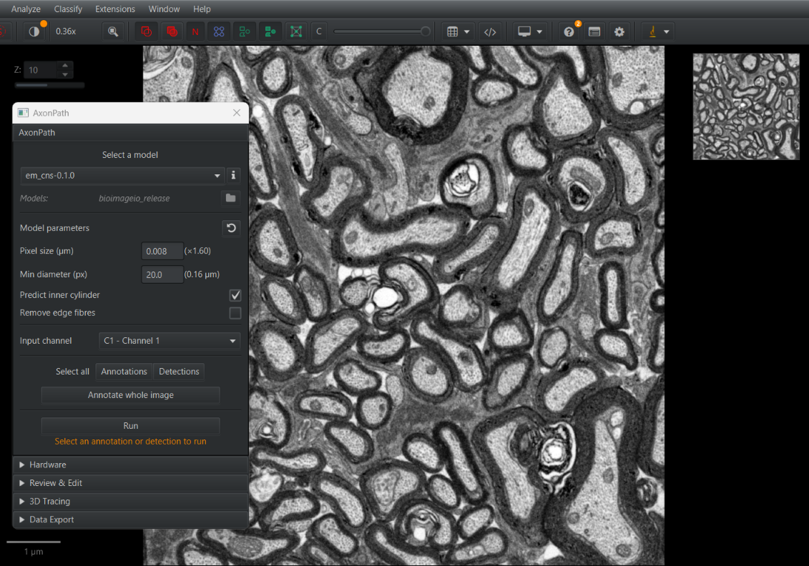
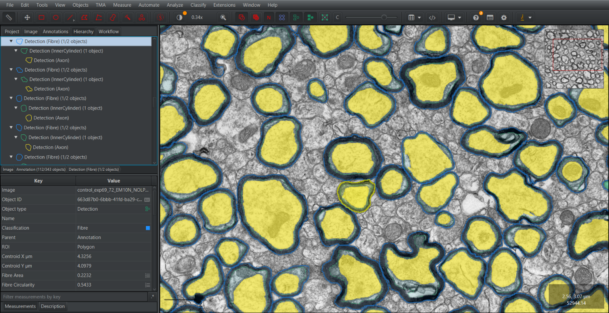

# Segmentation

This page explains how to segment myelinated fibres with the AxonPath panel. To process many images
at once, see [Scripting and batch processing](scripting.md).

Open the panel from **Extensions → AxonPath → AxonPath**.

## 1. Prepare the image

- **Set the pixel size.** AxonPath rescales images to the resolution the model was trained on, and
  reports measurements in µm, so the pixel size must be calibrated. Check it in the Image tab
  (*Pixel width* / *Pixel height*) and double-click a value to set it. Pixel width and height must be
  equal.
- **Use a project** if you want to export measurements or annotations later. Export works on project
  images (see QuPath's [Projects](https://qupath.readthedocs.io/en/stable/docs/tutorials/projects.html)
  page).
- **Image type:** QuPath asks for an image type when an image is opened. It has no electron
  microscopy type, so choose **Other** for EM images. AxonPath does not use the image type, so this
  does not change the results.
- **Optional: display single-channel images in grayscale.** QuPath may show a single-channel image
  with a colour tint, which can make objects harder to see when editing. Open **View →
  Brightness/Contrast**, double-click the channel and set its colour to white. This only changes the
  display, not the segmentation or the measurements.

## 2. Choose a model

The first time, click **Choose model directory** and select the folder that contains your model
folders (see [Models](models.md)). AxonPath remembers it. The folder name is shown next to
*Models:*; double-click it to open the folder on your computer.

Then pick a model from **Select a model**. Only folders containing both `weights.pt` and `rdf.yaml`
are listed. The info button next to the list summarises this.

Choose the model that matches your images:

| Model | Images | Model pixel size |
|---|---|---|
| `em_cns-0.1.0` | Electron microscopy, central nervous system | 0.008 µm |
| `em_pns-0.1.0` | Electron microscopy, peripheral nervous system | 0.03 µm |
| `brightfield-0.1.0` | Brightfield | 0.071 µm |

## 3. Check the model parameters

Selecting a model fills in its default parameters, read from its `rdf.yaml`. The defaults are
usually right; change them only for a reason. The reset button restores the model defaults.

### Pixel size (µm)

The pixel size the image is rescaled to before segmentation. It should match the resolution the
model was trained at, so leave it at the model default unless you have a reason to change it.

The number next to it shows how the image will be rescaled: **(×4)** means the image is downsampled
4 times. A factor below 1 (highlighted as a warning) means the image is **upsampled**: its pixels are larger than
the model's, so the model sees structures larger than it was trained on. Expect poorer results, and
consider a model trained at a resolution closer to your images.

When the image and model pixel sizes differ by less than 10%, the image is not rescaled at all.

The factor is also a check on the image calibration. For example, a brightfield image with 0.065 µm
pixels should show a factor close to ×1. If the factor is far from what you expect for your
microscope, check the image pixel size: a misplaced decimal point or a value entered in the wrong
unit (nm instead of µm) makes the model see structures at the wrong size.

### Min diameter (px)

The smallest object kept, as a diameter in pixels at the model's pixel size. Smaller objects are
discarded as noise. The equivalent size in µm is shown next to it.

Lower it if small fibres or axons are missed; raise it if small spurious objects appear.

### Predict inner cylinder

Segment inner cylinders (axon plus inner tongue). This gives the hierarchy Fibre → InnerCylinder →
Axon and the inner cylinder measurements (`InnerCylinder Area`, `Myelin g-ratio`, `InnerTongue`
intensities; see [Measurements](measurements.md)). When off, the hierarchy is Fibre → Axon.

On by default for EM models and off for brightfield, where the inner tongue cannot be resolved. You
can change it for any model; what matters for the results is this setting, not the image type.

When on, every fibre needs an inner cylinder containing its axon, so a region where the model finds
no inner cylinders gets no fibres.

AxonPath stores the setting on each parent it processes, as `AxonPath inner cylinders` (`true` or
`false`, shown as a column in the annotation measurement table). Recompute uses it to rebuild the
same hierarchy after [manual edits](review-and-edit.md#what-recompute-does).

### Remove edge fibres

Remove fibres touching the boundary of the region being processed. Fibres cut by the region edge have
incomplete shapes, which biases measurements such as area and g-ratio. Off by default.

## 4. Choose the input channel

AxonPath models take a single channel. Pick it from **Input channel**. The list shows channels as
C1, C2, and so on, with their names.

Single-channel (greyscale) images, e.g. 8-bit EM or brightfield images, have only C1. For images
with several channels, choose the one showing the fibres.

## 5. Choose the device

Open the **Hardware** section to choose the **Preferred device**:

- **cpu** always works.
- **gpu0** (and **gpu1**, ...) and **mps** appear only on computers set up for a GPU; see the
  optional [GPU setup](gpu.md).

If in doubt, use CPU. The choice is remembered.

## 6. Select the regions to segment

AxonPath segments inside **parent objects**: usually annotations drawn around the tissue of
interest. Select one or more before running:

- Draw and select annotations with QuPath's tools, or
- Use **Select all → Annotations** (or **Detections**) to select all of them in the image, or
- Click **Annotate whole image** to create and select an annotation covering the whole image. For
  z-stacks it creates one annotation per z-slice.

AxonPath objects (Fibre, InnerCylinder, Axon) cannot be used as parents.

## 7. Run

Click **Run**. The parents are processed one at a time, with progress shown below the button. The
panel is disabled until all parents are processed.

For each parent, AxonPath:

1. Rescales the region to the model's pixel size and runs the model on it, in tiles.
2. Turns the model output into fibres, axons and (optionally) inner cylinders.
3. Keeps only objects inside the parent, clipping those crossing its boundary.
4. Builds the hierarchy: each inner cylinder is assigned to the fibre containing it, and each axon to
   the inner cylinder (with inner cylinders) or fibre (without) containing it.
5. Removes incomplete objects: fibres without an axon (or, with inner cylinders, without an inner
   cylinder containing an axon), and axons or inner cylinders not inside a fibre.
6. Computes [measurements](measurements.md) for every fibre and its contents.
7. Locks the parent, so it is not moved or edited by accident, and stores the
   [inner cylinder setting](#predict-inner-cylinder) on it.

**Running again on the same parent replaces its previous results**, including manual corrections.
If the parent contains results converted to annotations for [editing](review-and-edit.md), the panel
asks before replacing them. Scripts replace them without asking.
Other annotations inside the parent are kept. Avoid running both a parent and an annotation nested
inside it: their results overlap in the nested region.

If no complete fibres are found, a notification says so. Check the pixel size, the channel and the
model.

## Results

The results are detection objects, organised under each parent:

| Predict inner cylinder | Hierarchy |
|---|---|
| On (default for the EM models) | Fibre → InnerCylinder → Axon |
| Off (default for the brightfield model) | Fibre → Axon |

View them in the Hierarchy tab, and their measurements with **Measure → Show detection
measurements**. See [Measurements](measurements.md) for what each measurement means.

## Next steps

- Correct errors by hand: [Review & Edit](review-and-edit.md)
- Link fibres across z-slices: [3D tracing](tracing.md)
- Export results: [Export](export.md)
